# Introduction

Low-light conditions often pose significant challenges for image
acquisition, leading to images that are dark, noisy, and lacking in
detail. These issues can severely impact the performance of various
computer vision applications such as object detection, recognition, and
tracking, which rely on high-quality images for accurate analysis. The
primary problem we aim to address is the enhancement of images captured
under low-light conditions to improve their quality and usability in
downstream applications.\
Our expectations are to develop a comprehensive understanding of
different low-light image enhancement techniques. Next, implementing and
evaluating state-of-the-art models such as MIRNet, pix2pix, and U-Net.
Then, comparing the performance of these models using objective metrics
to determine the most effective approach for low-light image
enhancement. Besides, we implement channel attention layer to improve
the performances. Finally, providing insights into the strengths and
weaknesses of each method and propose potential improvements.\

# Methodology

Low-light image enhancement aims to improve the visual quality of images
captured under poor lighting conditions. This involves techniques to
increase brightness, reduce noise, and enhance details without
introducing artifacts. The core idea is to model the transformation that
maps low-light images to their enhanced versions. These methods below
are includes in our project.

## Image Processing Beside Machine Learning (Yo)

There are several methods proposed for low-light enhancement without
using machine learning. These methods have an advantage in the
nonrequirement of datasets. Three of them are implemented to compare the
results with machine learning methods.\
In the low-light condition, the histogram of intensity of the image is
squiz to low parts. One method of low-light enhancement is spread out
the histogram equally distributed along all the values from 0 to 255. We
can adaptibly control the spreads of histogram based on the histogram of
input and a method is called CLAHE  [@CLAHE]. Since we would like to
enhance the brightness, we read the image as HSV channels and we applied
CLAHE to V channel which is directly affect the intensity. We also
processed simply shifting the histograms by some factors.\
Retinex Model is another method for low-light enhancement. In this
model, values in each channel is multiplied by a scalar max value in a
channel divided by a channel we choose to be standard. G channel is
usually choosen as it. This model assumes that the average of values in
each channel should be equal.\

## Unet model (Chanid)

U-Net is a convolutional neural network (CNN) architecture originally
designed for biomedical image segmentation. Due to its ability to
capture both local and global features, it has been widely adopted for
various image-to-image translation tasks, including low-light image
enhancement.\
U-Net follows an encoder-decoder structure with skip connections. The
encoder consists of convolutional layers and downsampling operations to
extract features at different resolutions. The decoder uses upsampling
operations to reconstruct the image to its original resolution. Skip
connections between the encoder and decoder ensure that fine-grained
details are preserved. This architecture allows U-Net to generate
high-quality enhanced images from low-light inputs.\
[@Unet]

{#MSE_Lambda width="75%"}

## cGAN Model (Yo)

Generative Adversarial Networks (GAN) model is a method to produce an
image using two neural networks: one for generating an image called a
generator and the other for distinguishing fake pictures and real
pictures called a discriminator. The discriminator evaluates the
generated image from the generator. Both networks are trained
alternatively in general and achieve to produce realistic fake pictures
at the end. Conditional GAN (cGAN) model adds constraint in generation
of the image and evaluation of the image. pix2pix model uses this cGAN
method to process an image. Each component in detail is as follows.

### Generator (Yo)

The generator network is responsible for transforming input images into
fake images. In this implementation, low-light image is made and produce
a fake image based on the neural networks. As the discriminator learns,
the generator is tuned to trick the discriminator. At the end, it will
produce a light enhanced image.

### Discriminator (Yo)

The discriminator network evaluates the quality of the images produced
by the generator. In this report's implementation, if the picture is
low-light, then it will be evaluated as fake and vice versa. As
generator produces high realistic images, discriminator tuned to
distinguish more subtle difference.

### pix2pix (Gabriel)

pix2pix is a cGAN designed for image-to-image translation tasks first
introduced in [@Pix2Pix]. pix2pix can transform input images into
desired output images by learning the mapping from input to output
images using paired datasets for your desire.\
Pix2pix consists of a generator and a discriminator. The generator
transforms the input image into the desired output image, while the
discriminator evaluates the realism of the generated image compared to
the ground truth. The training process involves a combination of
adversarial loss for each generator and discriminator and L1 loss to
ensure that the generated images are closely aligned with the ground
truth. This approach allows pix2pix to effectively enhance low-light
images by learning the mapping between low-light and well-lit images.\

## Attention Mechanism (Yo)

Attention Mechanisms play These mechanisms allow the generator to focus
on the most relevant parts of the image, ensuring that critical features
are enhanced and preserved. There are 2 significant mechanisms included,
firstly, Spatial attention mechanisms, which focus on identifying and
emphasizing the most important spatial regions in the feature maps. This
is particularly useful in image enhancement tasks where certain areas of
the image, such as edges, textures, or specific objects, need more
attention than others. Another one is Channel attention mechanisms,
which focus on highlighting the most important feature channels. Each
channel in a convolutional layer represents different types of features,
and channel attention helps the model prioritize channels that contain
the most relevant information for image enhancement.

### CBAM

Convolutional Block Attention Mechanism (CBAM) is a combination module
of channel attention and spatial attention introduced in [@CBAM].
Channel attention module calculate weights along feature channels so
that important features are more focused. Spatial attention module
calculate where the information is dense so that important position is
more focused.

## Mirnet (Chanid)

MIRNet (Multi-Scale Residual Network) is a deep learning model designed
for image restoration tasks, including low-light enhancement. It
combines multi-scale feature extraction, residual learning, and
attention mechanisms to achieve high-quality image enhancement.\
MIRNet employs a multi-scale architecture where features are extracted
at multiple resolutions, allowing the model to capture both fine details
and global context. Residual learning helps in training deep networks by
learning the residuals (differences) rather than direct mappings.
Attention mechanisms are used to enhance feature representations by
focusing on important features and suppressing irrelevant ones. The
combination of these components allows MIRNet to effectively enhance
low-light images, producing clear and detailed outputs.\
[@Mirnet]

# Implementation

## Datasets (Gabriel)

For the low light enhancement task, the dataset known as the LOL-dataset
(LOw Light) was used for training. This dataset comes from \"Deep
Retinex Decomposition for Low-Light Enhancement\" by \[Chen Wei, Wenjing
Wang, Wenhan Yang, Jiaying Liu\]. The dataset contains 485 low-light
training images, 15 low-light validation images and each their
respective normal light version. This dataset was specifically made for
low light enhancement, thus making it the perfect choice for this
assignment. These images are in the size of 600x400. The low light
condition was created by decreasing the exposure time so that far less
information was captured. Afterwards the image was synthesized so that
the information and illuminance of the image was the same as those found
in other images taken in low light conditions. For preprocessing, the
images have been cropped and flipped randomly.

## Removing Outliers (Duc)

We utilized several image characteristics to identify outliers: mean
intensity, standard deviation of intensity, and blurriness. These
features were chosen because they directly relate to the quality of the
images, particularly under low-light conditions:

- Mean intensity: This measures the average brightness of the image.
  Images with extremely low mean intensity are likely underexposed and
  contain little useful information.

- Standard deviation of intensity: This indicates the contrast within
  the image. Low standard deviation suggests a lack of detail, while
  high values indicate high contrast regions, which could either be
  useful features or noise.

- Blurriness: Measured using the variance of the Laplacian, this feature
  helps identify out-of-focus images. Blurry images typically have low
  variance in the Laplacian, indicating a lack of sharp edges.

  <figure id="figs:outlier_image" data-latex-placement="!htbp">
  <figure id="fig:hist-lit">
  
  <figcaption>Pixel intensity and frequency of well lit
  images</figcaption>
  </figure>
  <figure id="fig:cbam2">
  
  <figcaption>Mean intensity and blurriness of low light
  images</figcaption>
  </figure>
  <figure id="fig:cbam3">
  
  <figcaption>Detected outliers</figcaption>
  </figure>
  <figcaption>Removed outliers</figcaption>
  </figure>

Next, we employed the Z-score method to detect outliers for each of
these features. The Z-score represents how many standard deviations a
data point is from the mean of the dataset. A Z-score threshold of 3 was
used, meaning any data point more than 3 standard deviations away from
the mean was considered an outlier. This threshold is based on the
empirical rule, which states that in a normal distribution, 99.7% of the
data falls within three standard deviations of the mean, making values
outside this range highly unusual.

## Image Processings Beside Machine Learning (Yo)

The CLAHE is applyied to brightness channel for the first type of
process. The second type is multiplying the brightness channel by a
scalar 1.2 and clip the value by 0 to 255. The last type is applying
Retinex model with RGB channels.

The CLAHE method able to lit up but just a small portion compares to
models with machine learning. Histogram shifting method able to change
brightness but also the color is shifted. Some black points on the sky
appears as we multiply by a larger scalar. Retinex model did not enhance
the color. The maximum values of each channel was equal. The performance
metrics in Tab.  [1](#tab:non-ML){reference-type="ref"
reference="tab:non-ML"} supports this analyze. There is a limitation in
brighten color by just a single image processing since there are several
factors to enhance the lights well.

{#figs: Non-ML methods width="100%"}

::: {#tab:non-ML}
          Original    CLAHE    Multiplication   Retinex
  ------ ---------- --------- ---------------- ---------
   MRAE    10.46      10.42        10.44         10.46
   RMSE    10.46      10.42        10.44         10.46
   PSNR   -20.396    -20.366      -20.376       -20.396

  : Performance metrics: MRAE, RMSE, and PSNR for the models.
:::

## Unet model (Chanid)

In this project, we started by understanding and utilizing the U-Net
architecture. The architecture consists of an encoder-decoder structure
with skip connections, is well-suited for image-to-image translation
tasks due to its ability to preserve spatial information and context
while reconstructing images.\
We trained the model locally on our computer using a dataset of 5,000
paired low-light and normal-light images. The data preprocessing
involved splitting and normalizing the images. The U-Net model was
trained using a mean squared error (MSE) loss function, which measures
the average squared difference between the predicted and true pixel
values. We employed the Adam optimizer for efficient gradient-based
optimization.\

<figure id="MSE_Lambda" data-latex-placement="h!">

<figcaption>A pair of Low-light image and normal image</figcaption>
</figure>

The detail of our model is described below:\

### Hyperparameters

In this U-Net implementation, the following hyperparameters are used:\
Batch Size: 16\
Epochs: 50\
Optimizer: Adam optimizer\
Learning Rate: The default learning rate for the Adam optimizer (0.001)\
Loss Function: Mean Squared Error (MSE)\
Total number of images = 5000 (training) + 1000 (testing) = 6000\
Training Data Percentage = (5000/6000)×100 = 83.33 percent\
alidation/Testing Data Percentage = (1000/6000) × 100 = 16.67 percent\

### Layer Architecture path

**Encoder (Contracting Path)\**

Convolutional Layer (Conv2D):\
Each block in the encoder path includes two 3x3 convolutional layers
with ReLU activation and 'same' padding to preserve the spatial
dimensions.\
Max Pooling Layer (MaxPooling2D):\
Following the convolutional layers, a 2x2 max pooling layer with 'same'
padding reduces the spatial dimensions by half. This operation helps in
downsampling the feature maps while retaining important features.\
The specific layers in the encoder are as follows:\
c1: 64 filters, 3x3 kernel size, ReLU activation\
p1: 2x2 max pooling\
c2: 128 filters, 3x3 kernel size, ReLU activation\
p2: 2x2 max pooling\
c3: 256 filters, 3x3 kernel size, ReLU activation\
p3: 2x2 max pooling\
c4: 512 filters, 3x3 kernel size, ReLU activation\
p4: 2x2 max pooling\
Bottleneck\
c5: 1024 filters, 3x3 kernel size, ReLU activation\
**Decoder (Expansive Path)**\
UpSampling Layer (UpSampling2D):\
Each block in the decoder begins with an upsampling layer that doubles
the spatial dimensions.\
Concatenation Layer (Concatenate):\
This layer merges the upsampled feature maps with the corresponding
feature maps from the encoder path via skip connections.\
Convolutional Layer (Conv2D):\
Similar to the encoder, the decoder uses 3x3 convolutional layers with
ReLU activation to refine the combined features.

The specific layers in the decoder are as follows:\
u6: 2x2 upsampling, concatenation with c4\
c6: 512 filters, 3x3 kernel size, ReLU activation\
u7: 2x2 upsampling, concatenation with c3\
c7: 256 filters, 3x3 kernel size, ReLU activation\
u8: 2x2 upsampling, concatenation with c2\
c8: 128 filters, 3x3 kernel size, ReLU activation\
u9: 2x2 upsampling, concatenation with c1\
c9: 64 filters, 3x3 kernel size, ReLU activation\
**Output**\
The output layer is:\
Output: 3 filters, 3x3 kernel size, sigmoid activation for producing a
normalized RGB image.\
To monitor the model's performance, we implemented a custom callback to
calculate and print metrics such as Peak Signal-to-Noise Ratio (PSNR),
Mean Relative Absolute Error (MRAE), and Root Mean Squared Error (RMSE)
every 1,000 iterations. These metrics provide insights into the quality
of the image enhancement.\

## Pix2Pix (Gabriel)

To create the pix2pix model, we used the backbone from the code in
tutorial of tensorflow for pix2pix model [@pix2pix_url]. The pix2pix
model uses a cGAN which should be perfect combined with the LOL dataset,
considering that the model should be able to generate images based on
the input and use the discriminator to find a balance for a realistic
and color corrected output. For the LOL dataset to work in the pix2pix
model, the images had to be resizes into a bit divisable number. 256x256
was chosen. The model trained for 40 epochs, where each epoch consisted
of 1000 runs.\

{#MSE_Lambda width="100%"}

## Attention Mechanism (Yo)

The implemented program is produced based on original CBAM code
[@CBAM_original_code] and a code using tensorflow python module
[@CBAM_BEEILAB_code]. ChatGPT converted the later program to a class
style in order to fit the code in pix2pix code in [@pix2pix_url]. The
converted program missed activation functions and multiplication to
original input so that I modified it to make sure that it would be CBAM
module similar to the reference codes. The dataset is as same as in
pix2pix implementation and the architecture of model is as same as it
except inserting CBAM into layers.

CBAM is implemented only in the first layer of pix2pix. It is because
the reconstructed image seems to have some pixel switching when we apply
them in deeper layers. When we applied in upsampling part, it had a
similar issue.

The code is run on hpc in DTU. The maximum iteration is set to 10,000
and data is taken by each 100 itterations. Checkpoints are saved every
1000 itterations. It took about 2.5 hours to learn the model.

## Mirnet (Chanid)

In this project, we implemented the MIRNet (Multi-Scale Residual
Network) architecture to enhance low-light images. MIRNet is
specifically designed for high-quality image enhancement tasks,
including low-light image enhancement, and leverages advanced techniques
to achieve superior results.\
We used the pre-trained MIRNet model for low-light enhancement available
on the Hugging Face Hub. The model was loaded using the pretrained keras
function.\
In the preprocessing step, the input image was loaded and checked if
they are RGBA or RGB. If they are the RGBA type, they will be converted
to RGB due to the requirement of the model. It was then resized to
256×256 pixels to match the input size expected by the model. The image
was normalized to have pixel values between 0 and 1, which is a common
preprocessing step for neural networks.\
The preprocessed image was passed through the MIRNet model to generate
the enhanced image. The received output was then post-processed by
scaling the pixel values back to the range \[0, 255\].\
Finally, we displayed the original low-light image and the enhanced
image using Matplotlib to visually assess the improvement.\

# Results

In this section, we test and collect the results from each models we
studied in order to see how are each model effective on the real-world
situation.\

## Mirnet (Chanid)

The MIRNet model successfully enhances the brightness of low-light
images, making objects and features more visible. This improvement is
consistent across various scenes, such as underwater environments, dusk
landscapes, and nighttime street views. This enhancement significantly
aids in better understanding and analyzing the images.\
However, the model sometimes introduces color shifts that may not
accurately represent the natural scene. For instance, the underwater
image has a noticeable blue tint, and some images show inconsistent
color distributions which are obviously the room of improvement.\

{#MSE_Lambda width="100%"}

## Pix2Pix (Gabriel)

The result of pix2pix\
The first run with the pix2pix model using the 500 images from the LOL
dataset resizes to 256x256, running for 40 epochs. Dropout is applied in
the first three layers of the upconversion. During training the model
had some issues balancing the generator and discriminator. There was a
general trend of the discriminator dominating the model towards the end
of the training.

<figure id="fig:combined_metrics" data-latex-placement="htbp">
<figure id="fig:mrae">
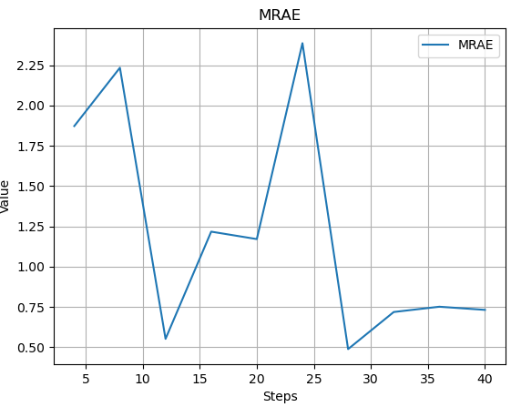
<figcaption>MRAE</figcaption>
</figure>
<figure id="fig:rmse">
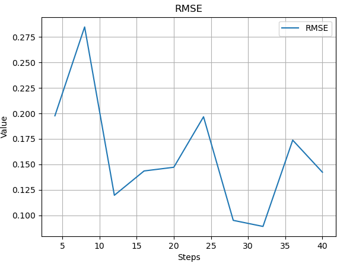
<figcaption>RMSE</figcaption>
</figure>
<figure id="fig:psnr">
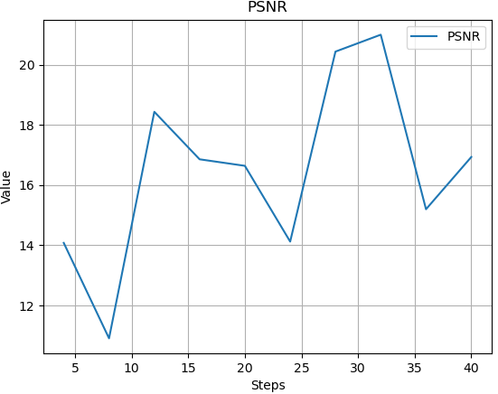
<figcaption>PSNR</figcaption>
</figure>
<figcaption>Combined performance metrics: MRAE, RMSE, and PSNR for the
model.</figcaption>
</figure>

looking at the MRAE, it can be seen that there is fluctuations during
the training, but generally a downgoing trend.

The RMSE is also fluctating, but ends in a lower value indicating a
better performance.

The PSNR is moving upwards overall during training, but oscillates a
bit, indicating a change of detail during the training.\
Looking at the visual output of the model, the result looks pretty good.
The noise is expected when generating the image since the original
dataset made the low light images synthetically noisy to simulate a real
low light image.

<figure id="fig:combined_metrics" data-latex-placement="!htbp">
<figure id="fig:mrae">
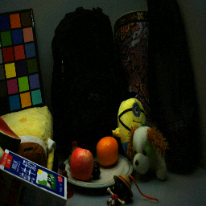
<figcaption>Input</figcaption>
</figure>
<figure id="fig:rmse">
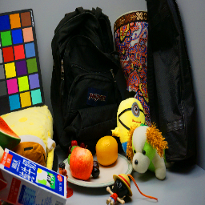
<figcaption>Ground Truth</figcaption>
</figure>
<figure id="fig:psnr">
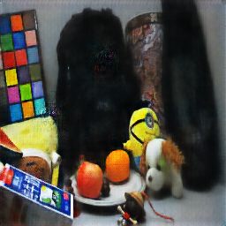
<figcaption>Prediction</figcaption>
</figure>
<figcaption>The output of the model.</figcaption>
</figure>

## CBAM (Yo)

The measurements during the learning are
Figs. [21](#figs:cbam_combined_metrics){reference-type="ref"
reference="figs:cbam_combined_metrics"}. MRAE and RMSE are decreasing
until 9000 iterations while PSNR is increasing until there. L1 loss was
also decreasing until there. We decided to terminate the learning at the
9000 iterations for this.

The result of CBAM reconstruction with the iteration is
Figs. [25](#figs:cbam_imgs){reference-type="ref"
reference="figs:cbam_imgs"}. It enhanced but not as in pix2pix model. It
became more blurry.

<figure id="figs:cbam_combined_metrics" data-latex-placement="htbp">
<figure id="fig:cbam_mrae">
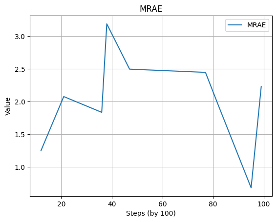
<figcaption>MRAE</figcaption>
</figure>
<figure id="fig:cbam_rmse">
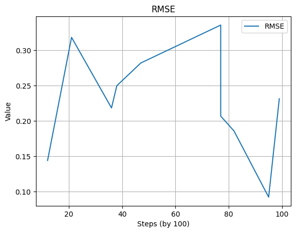
<figcaption>RMSE</figcaption>
</figure>
<figure id="fig:cbam_psnr">
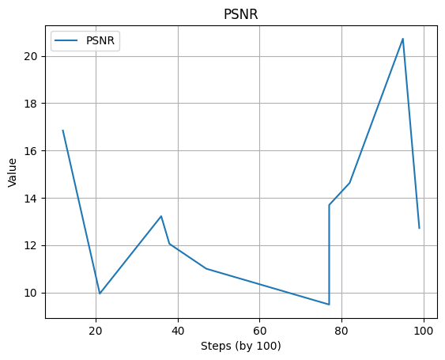
<figcaption>PSNR</figcaption>
</figure>
<figcaption>Combined performance metrics: MRAE, RMSE, and PSNR for the
model.</figcaption>
</figure>

<figure id="figs:cbam_imgs" data-latex-placement="!htbp">
<figure id="fig:cbam1">
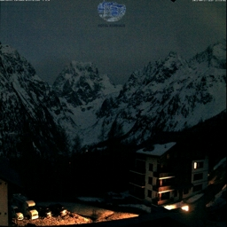
<figcaption>Input</figcaption>
</figure>
<figure id="fig:cbam2">
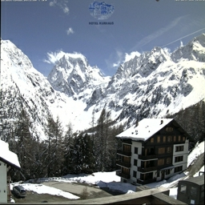
<figcaption>Ground Truth</figcaption>
</figure>
<figure id="fig:cbam3">
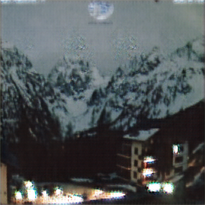
<figcaption>Prediction</figcaption>
</figure>
<figcaption>The output of the model.</figcaption>
</figure>

## Unet model (Chanid)

As a picture  [26](#fig:MSE_Lambda_1){reference-type="ref"
reference="fig:MSE_Lambda_1"} and
 [27](#fig:MSE_Lambda_2){reference-type="ref"
reference="fig:MSE_Lambda_2"} , the original low-light image is
characterized by significantly reduced visibility, with details obscured
due to poor lighting conditions. The overall brightness is low, and the
image suffers from a lack of contrast while The normal image provides a
clear, well-lit view of the scene with distinct details and good
contrast, serving as the target for enhancement.

{#fig:MSE_Lambda_1 width="100%"}

\

{#fig:MSE_Lambda_2 width="70%"}

The enhanced image produced by the U-Net model shows some improvement in
brightness and visibility. However, it is accompanied by significant
blurring and loss of detail, indicating that the model's enhancement is
not entirely successful. The image appears overly smooth in certain
areas, with an inconsistent enhancement effect. The skyline, for
instance, lacks clarity and appears washed out compared to the normal
image.\
Moreover, the presence of artifacts and the considerable blurring in the
enhanced image indicate deficiencies in the model's ability to preserve
spatial details. This could stem from insufficient training data or
suboptimal training configurations, such as the number of epochs,
learning rate, or batch size.\

# Analysis

In this study, we started with models without using machine learning for
low light enhancement and then applied machine learning methods. Unet
model, Pix2Pix model, CBAM modification in Pix2Pix, and MIRNET model are
deployed. One example pictures of low-light enhancement results are
shown in Fig. [28](#fig:compare_imgs){reference-type="ref"
reference="fig:compare_imgs"}. Evaluation of each test data is covered
in this section.

<figure id="fig:compare_imgs" data-latex-placement="h!">

<figcaption>The results comparison of each models</figcaption>
</figure>

## Evalution Metrics (Duc)

In this study, we use three key metrics: Mean Relative Absolute Error
(MRAE), Root Mean Square Error (RMSE), and Peak Signal-to-Noise Ratio
(PSNR).

- MRAE measures the relative absolute error between the predicted image
  and the ground truth image. It is particularly useful in scenarios
  where the pixel intensity varies significantly, as it normalizes the
  error by the actual pixel values.

- RMSE quantifies the average magnitude of the errors between the
  predicted and ground truth images. It is a commonly used metric that
  provides insight into the overall accuracy of the model by penalizing
  larger errors more severely due to the squaring term.

- PSNR is a widely used metric for assessing the quality of
  reconstructed images. It compares the maximum possible power of a
  signal (image) to the power of corrupting noise, measured in decibels
  (dB). Higher PSNR values typically indicate better quality images.

<figure id="figs:evaluating-metrics" data-latex-placement="!htbp">
<figure id="fig:MRAE">

<figcaption>MRAE</figcaption>
</figure>
<figure id="fig:rmse">

<figcaption>RMSE</figcaption>
</figure>
<figure id="fig:psnr">

<figcaption>PSNR</figcaption>
</figure>
<figcaption>Evaluation Metrics</figcaption>
</figure>

The average values of MRAE, RMSE, and PSNR for each model, as shown in
figure
[\[fig:metric-average\]](#fig:metric-average){reference-type="ref"
reference="fig:metric-average"}, provide a comprehensive summary of
model performance across the entire testing dataset.

::: {#tab:metric-average}
    Model           MRAE                 RMSE                 PSNR
  --------- -------------------- -------------------- --------------------
    CBAM     1.4359732031647217   10.331458031519944   10.743549655625259
   pix2pix   1.4771581038127848   10.307179960236008   10.346273342200742
   MirNet    1.1275018907558672   10.219654009391823    9.71377151414417
    Unet     1.1437832236426366   10.252251774886378   13.889451283575688

  : Evaluation metric average values
:::

## Color distortion (Duc)

To ensure that the enhanced images not only appear brighter but also
maintain accurate color representation, we conducted an analysis of
color distortion between the ground truth images and the generated
images.

We used the CIEDE2000 color difference formula to calculate the color
distortion between corresponding pixels in the ground truth and
generated images. This formula provides a perceptually uniform metric
for color differences, which aligns well with human vision.

The calculated color distortion was normalized to a scale of 0 to 1 for
consistent comparison and visual representation. A heatmap is generated
for each pair of an enhanced image and the corresponding ground-truth
image to visualize the color distortion. Finally, an average value of
color distortion for all images is calculated.

::: {#tab:color_distortion}
    Model    Average value of color distortion
  --------- -----------------------------------
    CBAM             35.80670853532699
   pix2pix          34.408380250372545
   MirNet           30.982678482317986
    Unet            18.756921502383573

  : Average values of color distortion CIEDE2000
:::

Since the light condition varies significantly between the low light
settings and well-lit settings, evaluation based on color distortion
(CIE 2000 deltae) turned out to not be a reliable method. For the future
work, more self-sufficient such as SSIM can be considered to validate
the color of the predicted images.

## Result Improvement (Gabriel)

One method that was discussed was the use of a ProGAN (Progressive GAN)
network which progressively increase the size of the training images
during training, from 64x64 to 128x128 to 256x256. This could make the
model more robust, and it could be further scaled to the size of 512x512
to minimize the detail loss since the original images are in the size of
600x400 in the LOL dataset.\
The training could be improved in the pix2pix model so that the
generator and discriminator remains balanced throughout the training.
The CBAM mechanisms should also be implemented deeper into the U-net
since it was only applied in the first downconversion layer and thus no
important features were found during training.\
All models exhibit some forms of artifacts or noise, since the images
are taken in low light conditions. It would be expected that to further
improve the models, some form of denoising or superresolution should
take place after the model has generated the image.\

# Conclusion (Gabriel)

The task of low light enhancement was tested using several methods, in
which at least pix2pix, CBAM and U-net proved to solve create normal
light images, although U-net would have some stronger outliers.

The pix2pix model and CBAM model created a visually coherent output
which resembles the ground truth fairly well, the models could
definitely be improved further on if there was more time for more
advanced learning using ProGAN or other methods.\

::: thebibliography
99

Histograms - 2: Histogram Equalization. OpenCV,
<https://docs.opencv.org/4.x/d5/daf/tutorial_py_histogram_equalization.html>.

P. Isola, Z. Jun-Yan, Z. Tinghui, and E. Alexei A. Image-to-Image
Translation with Conditional Adversarial Networks. arXiv:1611.07004,
2017.

<https://www.tensorflow.org/tutorials/generative/pix2pix>

W. Sanghyun, P. Jongchan, L. Joon-Young, and K In So. CBAM:
Convolutional Block Attention Module. arXiv:1807.06521, 2018.

<https://github.com/Jongchan/attention-module/tree/c06383c514ab0032d044cc6fcd8c8207ea222ea7>

<https://github.com/BEEILAB/Attention-Mechanism>

<https://gitup.com/soumik12345/MIRNet>

Z. Syed Waqas, A. Aditya, K. Salman, H. Munawar. Learning Enriched
Features for Real Image Restoration and Enhancement. rXiv:2003.06792v2
\[cs.CV\], 2020.

R. Olaf, F. Philipp, and B. Thomas. U-Net: Convolutional Networks for
Biomedical Image Segmentation. arXiv:1505.04597v1 \[cs.CV\], 2015.
:::
